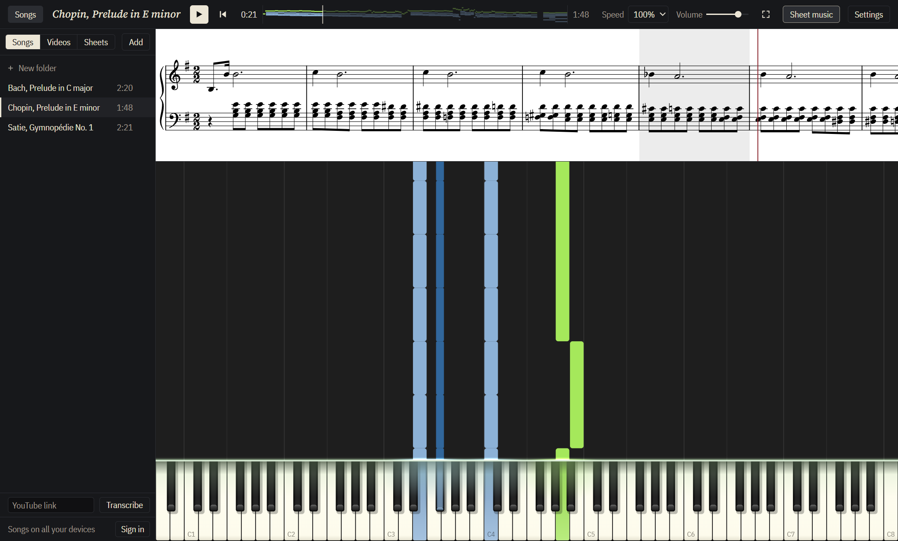

# MusicDen

<!-- A note from the creator. Replace the line below with a paragraph of your own. -->
> *A note from the creator goes here.*

MusicDen plays piano music as notes falling onto a keyboard, with the sheet music running along above them. Songs come from MIDI files, from a MIDI keyboard played live, or from a YouTube link: paste the link, and the piano notes in the recording are written out as a song, sorted into a left and a right hand. It runs on Windows, and in the browser of a phone, tablet or computer.



## Get it

### Windows

Download `MusicDen-win32-x64.zip` from the [latest release](../../releases/latest), unzip it anywhere, and open `MusicDen.exe`. Windows may say it does not know the publisher: choose More info, then Run anyway.

MIDI files and a MIDI keyboard work straight away. Some features run other programs, which have to be on the computer:

| To | Install |
| --- | --- |
| Turn YouTube links into songs | [Python](https://www.python.org/downloads/) and [FFmpeg](https://ffmpeg.org), then run `pip install "yt-dlp[default]" transkun` |
| See and save sheet music | [MuseScore Studio 4](https://musescore.org) |
| Save videos | [FFmpeg](https://ffmpeg.org), on the PATH or as `ffmpeg.exe` in a `bin` folder beside the app |

A recording is transcribed on an NVIDIA graphics card when the PyTorch on the computer can use one (its CUDA build, from [pytorch.org](https://pytorch.org/get-started/locally)), and otherwise on the processor, which takes longer. Settings ends with a Transcribing section that names the card, has a switch to leave the card alone, and says what a transcription under way is running on.

Songs are kept in `MusicDen` in your Music folder. Settings shows the folder and can move it.

### Phone, tablet or any browser

Open https://piano-visualizer.piano-visualizer.workers.dev. To keep it with your apps, open Settings in the app and choose Install app (Chrome and Edge), or on an iPhone or iPad tap Share, then Add to Home Screen. After its first visit it opens and plays without a connection. Transcribing links, sheet music and saving video need the Windows app.

### Accounts

Signing in keeps songs, folders and saved videos the same on every device. A song transcribed on the computer goes to the account by itself and is on the phone the next time the phone opens the app or syncs; a song removed on one device is removed from the others the same way. Each account has its own songs on a device. Signing out puts them away, and another account that signs in sees only its own.

## Build it yourself

```bash
npm install
```

```bash
npm run samples
```

```bash
npm start
```

`npm run samples` downloads the piano recordings (43 MB) into `app/assets/piano`. Without them the app still runs, with a plain synthesized tone.

To build a folder you can double-click (`dist/MusicDen-win32-x64/MusicDen.exe`):

```bash
npm run pack
```

Saving video needs [FFmpeg](https://ffmpeg.org) on the PATH, or an `ffmpeg.exe` in a `bin` folder beside the app.

Sheet music needs [MuseScore Studio 4](https://musescore.org) installed where its installer puts it. If it is somewhere else, set `MUSICDEN_MUSESCORE` to the full path of `MuseScore4.exe`.

Turning a YouTube link into a song needs yt-dlp and Transkun. This sets both up in a Python environment of their own (`%LOCALAPPDATA%\MusicDen\transcriber`):

```bash
npm run transcriber
```

A PyTorch already on the computer is used as it is, so one that can use the graphics card stays in use; the script ends by saying whether recordings will be transcribed on the graphics card or on the processor. The app also finds the programs if `yt-dlp` and `transkun` are on the PATH.

### Songs from links

A link goes through three programs (`app/main.cjs`): yt-dlp fetches the recording as a WAV file, Transkun writes out its piano notes, and `app/tools/hand_split.py` sorts the notes into a right-hand and a left-hand track. Transkun is trained on recordings of a piano alone; in a recording with singing or other instruments it takes those for piano notes too.

Transkun is run through `app/tools/transcribe.py`, which puts the work on the graphics card when Settings allows it and PyTorch can use one, and says on its first line which it is. While the card is at work it reports about once a second how much of the card's memory the transcription holds, which Settings shows under the switch. If the card gives up partway, the recording is transcribed over again on the processor.

## Phone version and accounts

The same app runs in a phone browser: `app/ui/boot.js` loads `desk-web.js` in place of the desktop shell, keeping songs in the browser's storage, and `phone.css` lays the panels over the stage. Saving video, link transcription and sheet music stay on the desktop. To try it on a phone on the same network:

```bash
npm run phone
```

The phone version is hosted on Cloudflare at https://piano-visualizer.piano-visualizer.workers.dev. After a change, this rebuilds `dist-phone` and puts it there (it needs `npx wrangler login` once):

```bash
npm run deploy
```

On a phone the picture is a centered 16:9 frame and a tap on the stage shows or hides the top strip (`phone.js`). Everything pressed there is finger-sized (`phone.css`), one panel is open at a time, and the screen stays on while a song plays. Each row in the Songs panel ends with a "more" button; it, or pressing and holding the row, opens a menu to rename the row, move a song into or out of a folder, or remove it (`more.js`), in place of the right-click, drag and small remove button a mouse uses.

The phone version is kept on the device by a service worker (`sw.js`, started by `offline.js`), so it opens at once and works without a connection. `npm run deploy` stamps the published `sw.js` with a version and the list of files: the app's own files are fetched together and replaced together when a newer version is published (the app moves to it by itself the next time it is opened, unless a song is playing or the app has been touched), and the piano's recordings are fetched once, a few at a time, while the app is open. Settings has a line saying how far that has got, and under it an Install app button where the browser offers to install the app. Served straight from the source folder (`npm run phone`) nothing is kept ahead of time and the server is always asked first.

A video saved on the desktop while signed in is also sent to the account (`videos.js`); the Songs panel switches between songs and those videos, which play in place of the stage on any device. The account takes files up to 50 MB, so a larger video is sent as a smaller copy.

Signing in and syncing songs between devices uses a Supabase project: run `supabase/setup.sql` in its SQL editor, then put its address and publishable key in `app/ui/cloud-config.js`. Until then the app shows no sign-in. `test/shots/phone.mjs` checks the phone version, syncing and accounts against a stand-in for that service.

### Whose songs a device shows

Each account's songs are kept apart on a device (`owner.js`). On the desktop they are in a folder of their own inside the song folder, named after the account's email; the songs added while no one is signed in are in the song folder itself. In a browser each account has its own database. Signing in shows that account's songs and moves the ones added while signed out over to it, together with the folders they were in and the sheet music saved as PDF; signing out puts the account's songs away where they are, untouched. So songs never pass from one account to another, and a song a link is still being transcribed for goes to whoever asked for it.

### Keeping a device and the account in step

A sync (`cloud.js`) runs on signing in, when the app starts, a moment after a song is added, changed or removed, and from the Sync button. Songs only on the device are sent, songs only in the account are fetched, and a song changed on one side replaces the other (the newer one when both changed). A song that was in step at the last sync and has since been removed on one side is removed on the other as well; if it was changed there meanwhile, the changed song is kept instead. Before a song is removed from a device, the account is asked for that song by name and has to answer that it has none. On the desktop a song removed this way goes to the Recycle Bin.

How both sides stood at the last sync is noted with the songs themselves: in `.sync.json` in the account's folder on the desktop, and in the account's database in a browser. A folder that is new, or swapped for another in Settings, therefore starts without a note, and its missing songs are fetched rather than taken for removed.

Folders in the Songs list group songs without moving their files (`folders.js`). Which songs each folder holds is kept on the device for each account and, as one small file, in the account (`folders.json`), so every device shows the same folders; the side where they were last changed replaces the other. Folders made before signing in are added to the account's own rather than replacing them.

## What it is made of

Electron, with a stage drawn in WebGL2 and sound through Web Audio. No runtime dependencies beyond Electron itself.

| File | What it does |
| --- | --- |
| `app/main.cjs` | The window, the songs on disk, native dialogs, and the programs that turn a link into a song. |
| `app/preload.cjs` | What the page may ask of the computer; runs FFmpeg for video. |
| `app/sheet.cjs` | Runs MuseScore to engrave a song as one long line of staves, and the hand-splitting script for a song with one track. |
| `app/tools/transcribe.py` | Runs Transkun on the graphics card or the processor, and says which. |
| `app/tools/hand_split.py` | Sorts the notes of a one-track song into a right and a left hand. |
| `app/ui/strings.js` | Every string a person can see. |
| `app/ui/midi.js` | Reads MIDI files; writes them back with notes moved between tracks and every other byte untouched. |
| `app/ui/piano.js` | The sampled piano: loudness layers, dampers, sustain pedal, and the soundtrack for videos. |
| `app/ui/stage.js` | One frame of the stage: what is on screen, sparks, the flat view, glow, frames for video. |
| `app/ui/solid.js` | The 3D view. |
| `app/ui/keys2d.js` | The flat keyboard. |
| `app/ui/gl.js` | Shaders for the flat view and the full-frame passes. |
| `app/ui/app.js` | Playback, the song list, settings, hand editing, MIDI keyboard, saving video, the links waiting to be transcribed. |
| `app/ui/owner.js` | Whose songs the device is showing: each account's are kept apart. |
| `app/ui/cloud.js`, `account.js` | Signing in, and keeping the device's songs and folders in step with the account. |
| `app/ui/folders.js` | Folders in the Songs list: making, opening, renaming and removing them, and dragging songs in and out. |
| `app/ui/more.js` | The phone layout's menu on each row of the Songs panel: rename, move to a folder, remove. |
| `app/ui/sw.js`, `offline.js` | The phone version kept on the device: opens at once, works without a connection, moves to newer versions by itself, and can be installed. |
| `app/ui/sheet.js` | The sheet music band: the file handed to MuseScore, the marker, turning, clicking a measure, saved lines. |
| `app/ui/sheets.js` | The Sheets list in the Songs panel and the pages of a saved PDF shown over the stage. |
| `app/ui/beats.js` | Finds the beat, the measure and the time signature of a piece played in free time. |
| `app/ui/settings.js` | Defaults and what is remembered between runs. |

### Changing hands, and what happens to the file

Notes are paired with the exact events they came from. A file is written by copying every track that no note moved through as it was read, and rebuilding only the tracks a note left or entered, with each remaining event's bytes unchanged. A file with nothing moved comes back byte-identical, so undoing every change restores the original file exactly. A one-track file gains a second track for the other hand and becomes a format 1 file.

### Sheet music

The band is engraved by MuseScore, not by the app. The app writes a MIDI file from the notes as they stand: the meter, then one track for each hand, the higher hand first, each opening with the song's first key signature (MuseScore reads the key from the note tracks, and picks one itself when a song has none). Tempo is left out so that no tempo marks crowd the staff; MuseScore's times, counted at a steady pace, are turned back into the piece's seconds with the song's own tempo map. MuseScore reads it with its own staff splitting turned off, so each hand keeps a staff, and lays it out on a page 270 inches wide, which makes one long system; a longer song runs on to further pages, set side by side. Three exports run at once: the pages as SVG, and two lists giving the place and time of every measure and of every note column. The marker moves between note columns by the playback clock, and the line turns when the current measure, or the next one if both fit, is not wholly in view. Clefs and key stay pinned at the left after a turn, which is why only the song's first key signature is passed on. Moving notes between hands engraves the line again, about two seconds later. A song with all its notes in one track has no hands to go by; `app/tools/hand_split.py` sorts its notes into a right and a left hand, run with the Python that `npm run transcriber` sets up or one on the PATH (`MUSICDEN_PYTHON` names another). With no Python the notes from middle C up go on the upper staff and the rest on the lower one.

A song played in free time, such as one written out from a recording, has no tempo or meter in its file, and MuseScore makes clutter of it as it stands. For such a song (fewer than six in ten notes on the grid of its own file) the app first finds the beat from the notes themselves: it follows the quick pulse through the piece, allowing the pace to drift, then reads from where the low, long and loud strokes fall how those pulses group into written beats and measures and whether they divide in two or in three. The notes are then written by those beats, each stroke on the simplest cut of its beat, each hand as one line of chords, and MuseScore engraves that. The marker is timed by the same beats, so it follows the recording however the pace wanders.

What MuseScore gives back is saved for each song in the app's own data folder (`sheet-music`, about 40 KB a song), together with a fingerprint of the file it was engraved from. Opening the song again shows the saved line at once, also on a run where MuseScore is missing; the line is engraved again only when the fingerprint no longer matches, which is to say when the notes or the hands have changed. The last few lines are also kept in memory, so undoing a hand change shows the earlier line without engraving.

Save as PDF in Settings has MuseScore lay the same file out on ordinary pages. The PDF is kept in the app's data folder (`sheets`, with a folder inside it for each account), with its pages as pictures beside it; the Sheets list in the Songs panel shows those pictures over the stage, so no PDF viewer is needed, and Show in folder leads to the PDF itself.

### Video

Each frame is drawn at the video's size, converted to NV12 (BT.709) on the graphics card, read back, and piped to FFmpeg, which uses the graphics card's H.264 encoder when there is one. The soundtrack is rendered from the same piano ahead of time and muxed in as AAC.

## Checks

```bash
npm test
```

runs the tests of the MIDI reader and writer, of the file written for sheet music, and of the beat finder (on the test pieces replayed with a wandering pace, where the true beats are known). The scripts in `test/shots` start the real app, drive it, and save pictures to `test/out`:

| Script | Checks |
| --- | --- |
| `features.mjs` | Song list, playback, settings, removing a song. |
| `edit.mjs` | Changing hands by click and drag, the file on disk byte by byte, and the result in MuseScore 4. |
| `play.mjs` | Mouse, computer keys and MIDI messages in both views; picking notes in 3D. |
| `sound.mjs` | Pitch, loudness across velocities, dampers and pedal, measured from rendered sound. |
| `solid.mjs` | Pictures of the 3D view in several settings. |
| `flat.mjs` | Pictures of the flat view's other settings; measures that glow leaves note colors exact. |
| `packed.mjs` | Starts the built app from `dist` (not part of `npm run checks`). |
| `sheet.mjs` | The sheet music band: hands on their staves before and after a change, the marker against the file's own timing, turning, clicking a measure, a one-track song sorted into hands, a song longer than one page, a song played in free time, the band without MuseScore, and lines saved and shown again. Needs MuseScore 4 and a Python. |
| `sheets.mjs` | Sheet music as PDF: saved from Settings, listed under Sheets, opened over the stage, removed. Needs MuseScore 4. |
| `video.mjs` | Saves a video and checks its size, frame rate, sound, colors and how long it took. |
| `misc.mjs` | The Space key, adding files, speed, mute, full screen, removing the built-in piece, reopening the last song, the empty stage. |
| `link.mjs` | A song from a link: fetches a recording, transcribes it, and compares the notes with the ones played; what Settings says the transcription is running on, with the graphics card switch on and off; more links given meanwhile wait their turn, and one that fails stays listed (not part of `npm run checks`; takes minutes). |
| `phone.mjs` | The phone version beside the desktop app, against a stand-in for the account service: songs, folders and videos kept in step, a song removed on one device removed on the other, and a second account that gets nothing of the first's (not part of `npm run checks`; takes minutes and needs FFmpeg). |
| `folders.mjs` | Folders in the Songs list: making one, dragging songs in and out, opening, renaming, removing, and still there after a restart. |
| `touch.mjs` | The phone layout under a finger, lying down and upright: sizes of what is pressed, one panel at a time, the row menu by its button and by press and hold, the screen kept on while playing. |
| `offline.mjs` | The published phone version with its server shut down: it still opens and plays; then a newer version is published and the app moves to it. |

```bash
npm run checks
```

runs them all.

## Credits

Piano: Salamander Grand Piano V3 by Alexander Holm, [CC BY 3.0](https://creativecommons.org/licenses/by/3.0/), in the edition prepared for Tone.js Piano.
Typefaces: IBM Plex Sans Condensed and Source Serif 4, both under the SIL Open Font License (see `app/assets/fonts`).
Test pieces in `test/fixtures` are from the Mutopia Project.
Transcription: [Transkun](https://github.com/Yujia-Yan/Transkun) by Yujia Yan and Zhiyao Duan. Recordings are fetched with [yt-dlp](https://github.com/yt-dlp/yt-dlp), and sheet music is engraved by [MuseScore Studio](https://musescore.org). None of the three is included: each is installed separately and run as its own program.

## License

[MIT](LICENSE)
